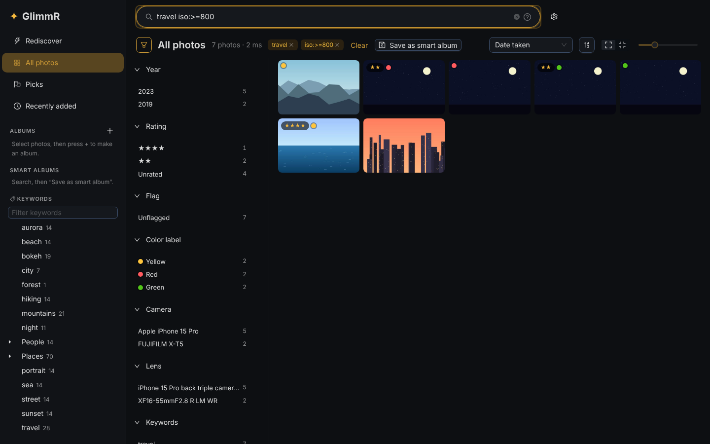
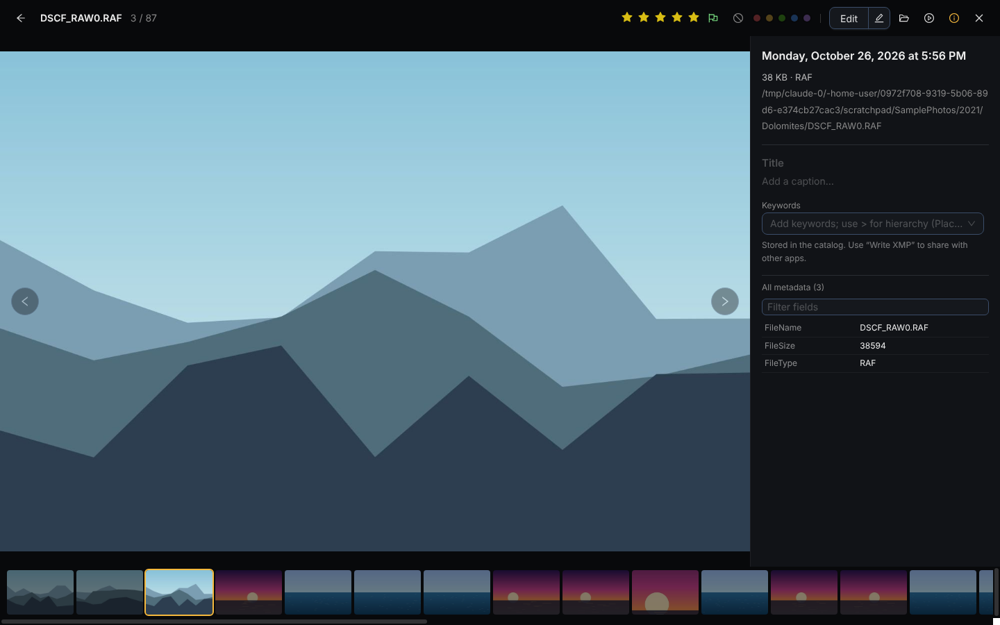
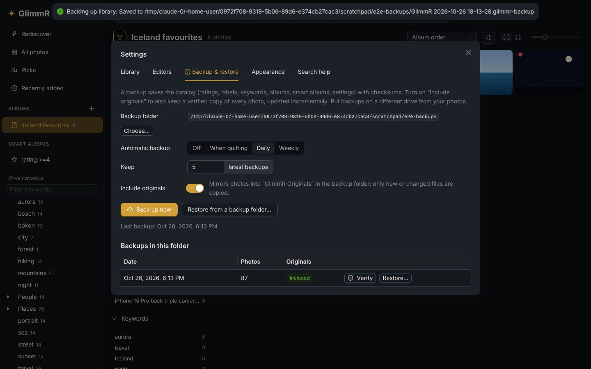
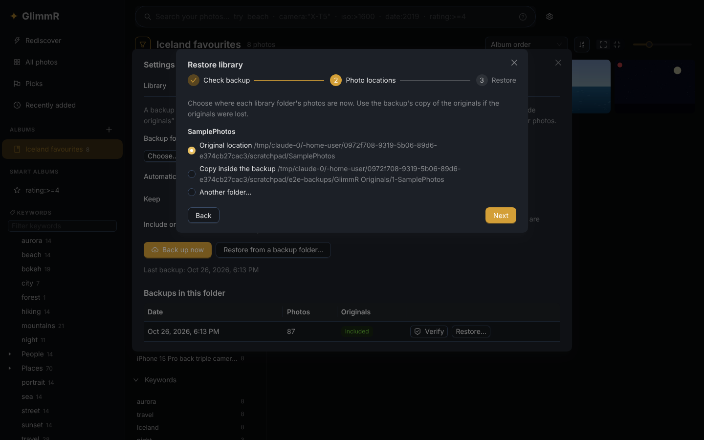

# GlimmR

**A calm, fast desktop library for your photos.** GlimmR stores, sorts, organizes, searches and shows a personal
photo collection on Windows and macOS. It browses like a stock-media site (one big search box, facets beside a
dark grid of large previews) and hands photos to Lightroom, Capture One or any editor you choose. It does not
edit photos.


- **Your files stay where they are.** Add folders; GlimmR catalogs them in place and never moves, renames or
  modifies originals.
- **Search by anything.** Free text over every field, plus `camera:"X-T5"`, `iso:>1600`, `focal:24..70`,
  `date:2019-07`, `rating:>=4`, `-keyword:test`, and any raw EXIF/IPTC/XMP key such as `ExposureProgram:Manual`.
  Sort by any field too.
- **Facets with counts.** Year, rating, flag, color label, camera, lens, keywords, file type, orientation, and
  ISO/focal/aperture ranges. Click to include, ⊖ to exclude. Save any search as a smart album.
- **Cull with the keyboard.** `0–5` stars, `P` pick, `X` reject, `6–9` color labels, optional auto-advance.
- **Rewarding to browse.** Rediscover home with *On this day*, highlights, *A look back*, shuffle and slideshow.
- **Open in your editor.** `Ctrl/⌘ E` opens the selection in your default editor, with per-type defaults
  (e.g. RAW → Capture One, JPEG → Photoshop). Editors are detected automatically, and you can add any app.
- **Backup and restore.** Catalog backups with checksums and SQLite integrity checks, on a schedule with
  retention, plus an optional verified, incremental mirror of the originals. The restore wizard verifies the
  backup and lets you remap each library folder, including to the backup's own copy of the originals.
- **Interoperable.** Reads ratings, labels and keywords from Lightroom, Capture One, Bridge and darktable sidecars.
  It can write them back to XMP sidecars, merging with existing ones.

| Search and facets | Viewer |
|---|---|
|  |  |
| **Backups** | **Restore wizard** |
|  |  |

Product docs: [research](docs/RESEARCH.md) · [PRD](docs/PRD.md)

## Run it

Requirements: Node.js 22+ and npm.

```bash
npm install
npm run dev        # development with hot reload
npm run build      # production build into out/
npm start          # run the production build
npm test           # unit + integration tests (catalog, search, scanning, backup/restore, XMP, editors)
npm run typecheck
```

Installers (build on the target OS so the right native image library is bundled):

```bash
npm run dist:win   # Windows NSIS installer (x64 + arm64) in dist/
npm run dist:mac   # macOS DMGs (arm64 + x64) in dist/ — sign and notarize for distribution
```

Set `GLIMMR_USER_DATA=/some/folder` to keep the catalog somewhere other than the default app-data folder (for
portable use or testing).

## How it works

```
Electron main (Node)                                    Renderer (React + Ant Design)
 ├─ catalog.db  SQLite (node:sqlite, WAL, FTS5)          ├─ Search bar with autocomplete + chips
 ├─ scanner     walk → exifr metadata → sharp previews   ├─ Facets, virtualized grid, selection bar
 ├─ query       search syntax → parameterized SQL        ├─ Viewer, Rediscover, Settings
 ├─ editors     detect + launch                          └─ talks to main via a typed IPC bridge
 ├─ backup      VACUUM INTO snapshot, SHA-256 manifest,
 │              originals mirror, verify, restore
 └─ glimmr://   thumbnails, previews and originals
```

- **Catalog**: `photos` (normalized fields), `metadata` (every EXIF/IPTC/XMP key/value, numeric values typed for
  comparisons and sorting), `keywords` (hierarchical, `Places>Portugal>Lisbon`), `albums`, `smart_albums`,
  `settings`, and a full-text index over all text.
- **Previews**: RAW files are never decoded. GlimmR extracts the largest embedded JPEG, which is why browsing
  RAW is fast. HEIC falls back to the embedded thumbnail, or to `sips` on macOS. Formats Chromium can't display
  are viewed through 2560 px previews; JPEG, PNG, WebP and AVIF show the original at 100% zoom.
- **Your data**: the catalog lives in the app-data folder (`%APPDATA%\GlimmR\Library` or
  `~/Library/Application Support/GlimmR/Library`). Previews are a disposable cache.
- **Editors**: Lightroom Classic and Capture One are catalog-based, so opening a file outside their catalog
  shows their import window. Ratings and keywords only reach them through XMP sidecars (Settings → Library →
  *Write XMP*, or *Write XMP* on a selection).

## Keyboard

| Key | Action |
|---|---|
| `/` or `Ctrl/⌘ K` | Search |
| Arrows, `Home`, `End` | Move; `Shift` extends the selection |
| `Enter` / double-click | View |
| `0`–`5` | Star rating |
| `P` / `X` / `U` | Pick / reject / unflag |
| `6`–`9` | Red / yellow / green / blue label |
| `Ctrl/⌘ E` | Open in editor |
| `S` | Slideshow |
| `I` | Info panel (viewer) |
| `Z` / `Space` / click | Zoom to 100% (viewer) |
| `Ctrl/⌘ A`, `Esc` | Select all, clear / back |

## Status

v1.0 MVP: all P0 requirements in the [PRD](docs/PRD.md) are implemented. Planned next (P1): folder watching,
RAW+JPEG stacking, map view, color search, compare view and automatic XMP writing.
