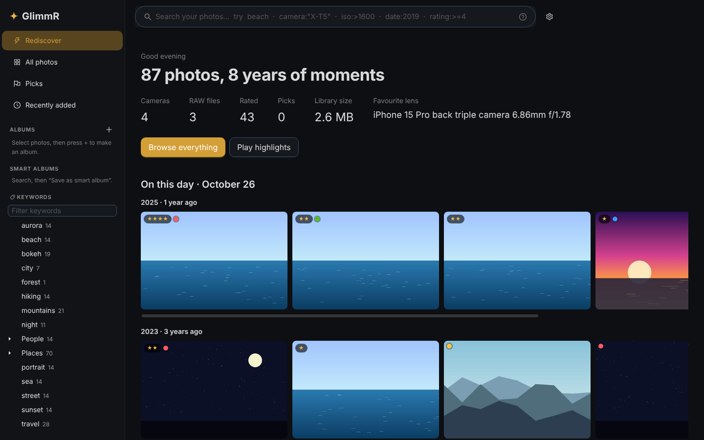
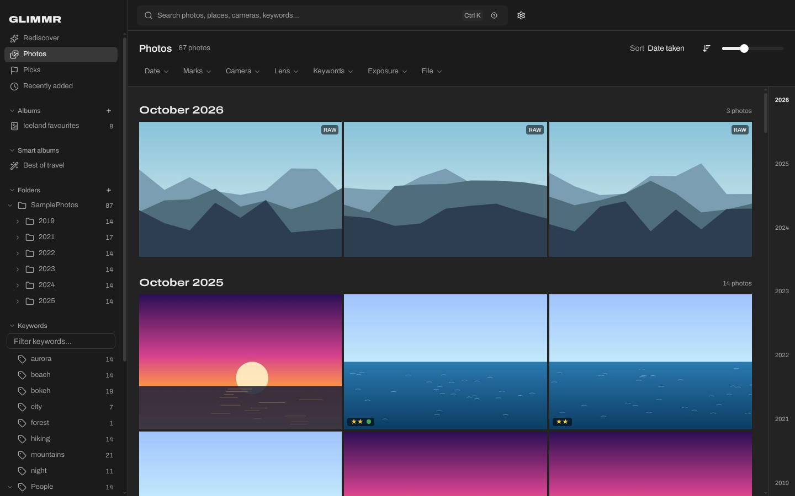
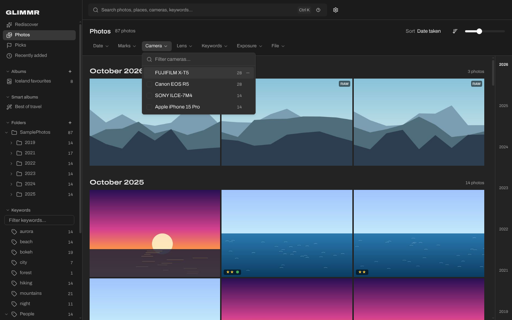
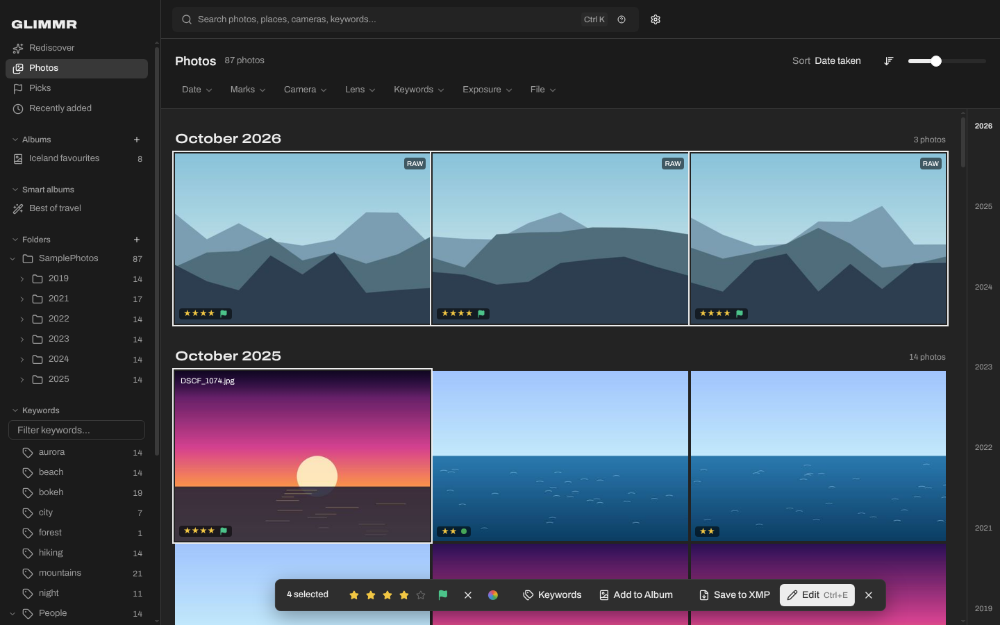
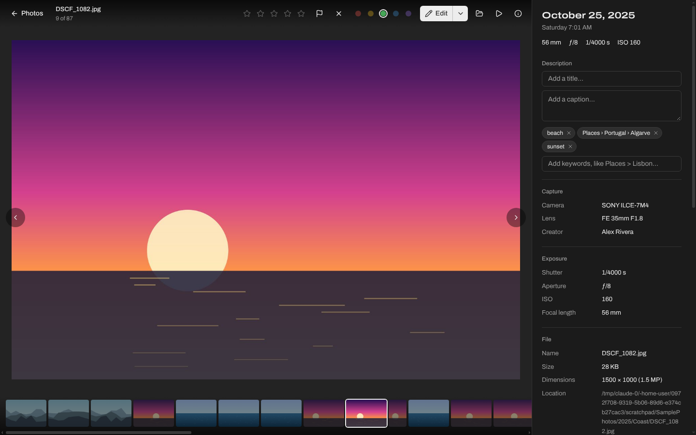
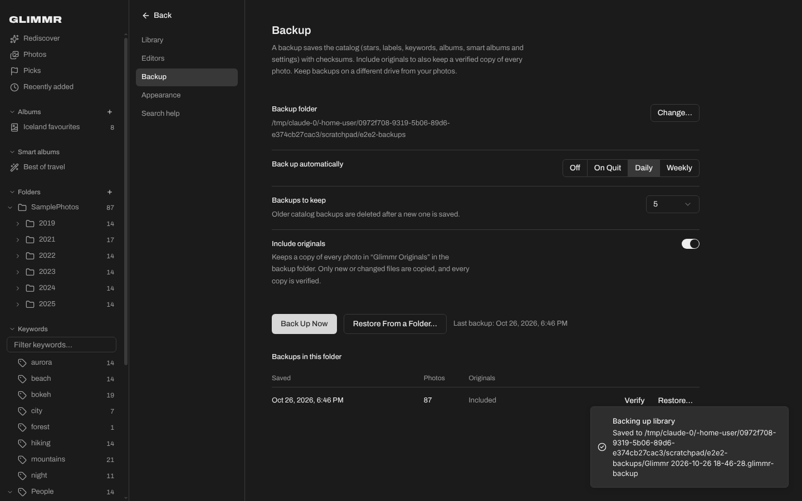
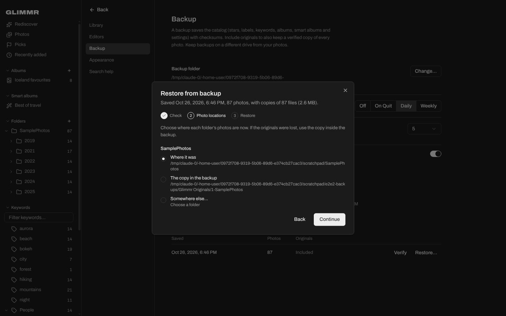

# Glimmr

**A calm, fast desktop library for your photos.** Glimmr stores, sorts, organizes, searches and shows a personal
photo collection on Windows and macOS. It browses like a stock-media site (one big search box, a filter bar and a
grid of photos at their true shapes) and hands photos to Lightroom, Capture One or any editor you choose. It does not
edit photos.



- **Your files stay where they are.** Add folders; Glimmr catalogs them in place and never moves, renames or
  modifies originals.
- **Search by anything.** Free text over every field, plus `camera:"X-T5"`, `iso:>1600`, `focal:24..70`,
  `date:2019-07`, `rating:>=4`, `-keyword:test`, and any raw EXIF/IPTC/XMP key such as `ExposureProgram:Manual`.
  Sort by any field too.
- **Facets with counts.** Year, rating, flag, color label, camera, lens, keywords, file type, orientation, and
  ISO/focal/aperture ranges. Click to include, ⊖ to exclude. Save any search as a smart album.
- **Cull with the keyboard.** `0–5` stars, `P` pick, `X` reject, `6–9` color labels, optional auto-advance.
- **Rewarding to browse.** Rediscover home with *On this day*, highlights, *A look back*, shuffle and slideshow.
- **Open in your editor.** `Ctrl/⌘ E` opens the selection in your default editor, with per-type defaults
  (e.g. RAW → Capture One, JPEG → Photoshop). Editors are detected automatically, and you can add any app.
- **Backup and restore.** Catalog backups with checksums and SQLite integrity checks, on a schedule with
  retention, plus an optional verified, incremental mirror of the originals. The restore wizard verifies the
  backup and lets you remap each library folder, including to the backup's own copy of the originals.
- **Interoperable.** Reads ratings, labels and keywords from Lightroom, Capture One, Bridge and darktable sidecars.
  It can write them back to XMP sidecars, merging with existing ones.

| Photos by month | Filters |
|---|---|
|  |  |
| **Culling a selection** | **Viewer** |
|  |  |
| **Backup** | **Restore** |
|  |  |

Product docs: [research](docs/RESEARCH.md), [PRD](docs/PRD.md) and [UI design](docs/DESIGN.md).

## Design

The interface follows [docs/DESIGN.md](docs/DESIGN.md). Photos sit on neutral grey so their colours read
correctly, every photo keeps its real shape in justified rows grouped by month, and a year scrubber jumps
through time. It's built with shadcn/ui (Radix) and Tailwind CSS v4, and checked against Vercel's Web Interface
Guidelines and Anthropic's frontend-design guidance.

The wordmark is set in **Akira Expanded**. It's a commercial font, so it isn't included. Glimmr uses it if it's
installed, or if you put a licensed `akira-expanded.woff2` (or `.otf`/`.ttf`) in `src/renderer/public/fonts/`.
Otherwise a close fallback is used. All other text is **Archivo**, whose width axis gives headings the same
expanded proportions.

## Run it

Requirements: Node.js 22+ and npm.

```bash
npm install
npm run dev        # development with hot reload
npm run build      # production build into out/
npm start          # run the production build
npm test           # unit + integration tests (catalog, search, scanning, backup/restore, XMP, editors)
npm run typecheck
```

### Installers and automatic builds

GitHub Actions (`.github/workflows/build.yml`) runs on every push:

1. Typecheck and tests on Linux.
2. **Windows** installer (`Glimmr-<version>-Windows-Setup.exe`, x64 and ARM in one installer) built on Windows.
3. **macOS** disk images for Apple Silicon and Intel (`Glimmr-<version>-macOS-arm64.dmg` / `-x64.dmg`) built on macOS.

Branch builds attach the installers to the workflow run (Actions tab → run → Artifacts).

To build locally on the matching OS: `npm run dist:win` or `npm run dist:mac`.

### Publishing an update

Installed copies of Glimmr check this repository's **GitHub Releases** shortly after they start and every 4 hours.
They download new versions in the background and offer **Restart to Update** in the sidebar and in
Settings → Updates.

To publish a version:

```bash
npm version 1.1.0          # bumps package.json and creates the tag v1.1.0
git push --follow-tags     # CI builds both platforms and publishes the release
```

Or, without a tag: set the version in `package.json`, push, then in GitHub open **Actions → Build → Run workflow**,
tick **release** and run it. CI tags `v<version>` itself.

Either way, CI creates a draft release, uploads the Windows and macOS installers plus the update manifests (`latest.yml`,
`latest-mac.yml`), and publishes the release only after both platforms succeed. Installed apps never see a
half-finished release. A tag that doesn't match `package.json` fails the build.

### Code signing

Builds work without certificates, with these limits:

- **Windows:** unsigned installers show a SmartScreen warning the first time. Updates install normally.
- **macOS:** builds are ad-hoc signed. People open the first install with right-click → Open. macOS only lets an app
  replace itself when it's signed with an Apple Developer ID, so unsigned builds show **Get the New Version**,
  which opens the release page, instead of updating in place.

For silent updates on macOS and no warnings, add these repository secrets (Settings → Secrets and variables →
Actions): `MAC_CSC_LINK` (base64 Developer ID Application .p12), `MAC_CSC_KEY_PASSWORD`, `APPLE_ID`,
`APPLE_APP_SPECIFIC_PASSWORD`, `APPLE_TEAM_ID`. For Windows, add `WIN_CSC_LINK` and `WIN_CSC_KEY_PASSWORD`.
CI picks them up automatically, and macOS builds are then notarized too.

Set `GLIMMR_USER_DATA=/some/folder` to keep the catalog somewhere other than the default app-data folder (for
portable use or testing).

## How it works

```
Electron main (Node)                                    Renderer (React + shadcn/ui + Tailwind)
 ├─ catalog.db  SQLite (node:sqlite, WAL, FTS5)          ├─ Search bar with autocomplete + chips
 ├─ scanner     walk → exifr metadata → sharp previews   ├─ Filter bar, justified grid, selection bar
 ├─ query       search syntax → parameterized SQL        ├─ Viewer, Rediscover, Settings
 ├─ editors     detect + launch                          └─ talks to main via a typed IPC bridge
 ├─ backup      VACUUM INTO snapshot, SHA-256 manifest,
 │              originals mirror, verify, restore
 └─ glimmr://   thumbnails, previews and originals
```

- **Catalog**: `photos` (normalized fields), `metadata` (every EXIF/IPTC/XMP key/value, numeric values typed for
  comparisons and sorting), `keywords` (hierarchical, `Places>Portugal>Lisbon`), `albums`, `smart_albums`,
  `settings`, and a full-text index over all text.
- **Previews**: RAW files are never decoded. Glimmr extracts the largest embedded JPEG, which is why browsing
  RAW is fast. HEIC falls back to the embedded thumbnail, or to `sips` on macOS. Formats Chromium can't display
  are viewed through 2560 px previews; JPEG, PNG, WebP and AVIF show the original at 100% zoom.
- **Your data**: the catalog lives in the app-data folder (`%APPDATA%\Glimmr\Library` or
  `~/Library/Application Support/Glimmr/Library`). Previews are a disposable cache.
- **Editors**: Lightroom Classic and Capture One are catalog-based, so opening a file outside their catalog
  shows their import window. Ratings and keywords only reach them through XMP sidecars (Settings → Library →
  *Write XMP*, or *Write XMP* on a selection).

## Keyboard

| Key | Action |
|---|---|
| `/` or `Ctrl/⌘ K` | Search |
| Arrows, `Home`, `End` | Move; `Shift` extends the selection |
| `Enter` / double-click | View |
| `0`–`5` | Star rating |
| `P` / `X` / `U` | Pick / reject / unflag |
| `6`–`9` | Red / yellow / green / blue label |
| `Ctrl/⌘ E` | Open in editor |
| `S` | Slideshow |
| `I` | Info panel (viewer) |
| `Z` / `Space` / click | Zoom to 100% (viewer) |
| `Ctrl/⌘ A`, `Esc` | Select all, clear / back |

## Performance

Measured on a synthetic catalog of 100,000 photos (15 metadata fields and 2 keywords each) in this
project's Linux container, query time only:

| Query | Time |
|---|---|
| All photos, newest first | 115 ms |
| Free text (`beach`, prefix `moun`) | 32–48 ms |
| `keyword:=dog`, `date:2010..2012 rating:>=3` | 35–47 ms |
| Sort by a raw metadata key | 134 ms |
| `ShutterCount:>150000` / `ExposureProgram:Manual` | 110 / 233 ms |
| `camera:"EOS R5" iso:>1600` (substring match over all rows) | 305 ms |
| Exclusions matching 77% of the library | 466 ms |
| Facet panel (computed after results, in the background) | ~600 ms |

Most searches meet the PRD's 150 ms target. Substring matches on camera and broad exclusions don't yet.

## Status

v1.0 MVP: the PRD's P0 requirements are implemented, with these gaps:

- Dragging photos onto an album (ORG-1) isn't built yet. Use the selection bar, the context menu or "+" in
  the sidebar instead.
- Performance targets are met for most queries; see the table above.

Planned next (P1): folder watching, RAW+JPEG stacking, map view, color search, compare view and automatic XMP
writing.
