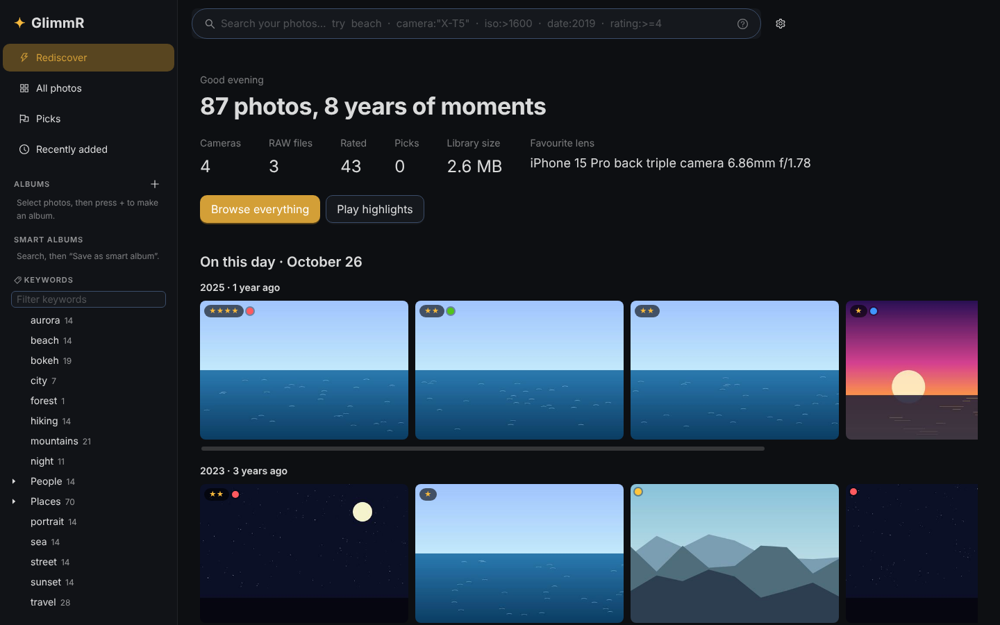
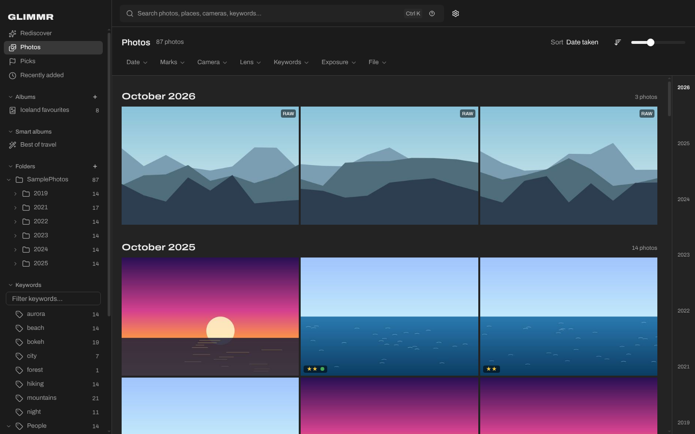
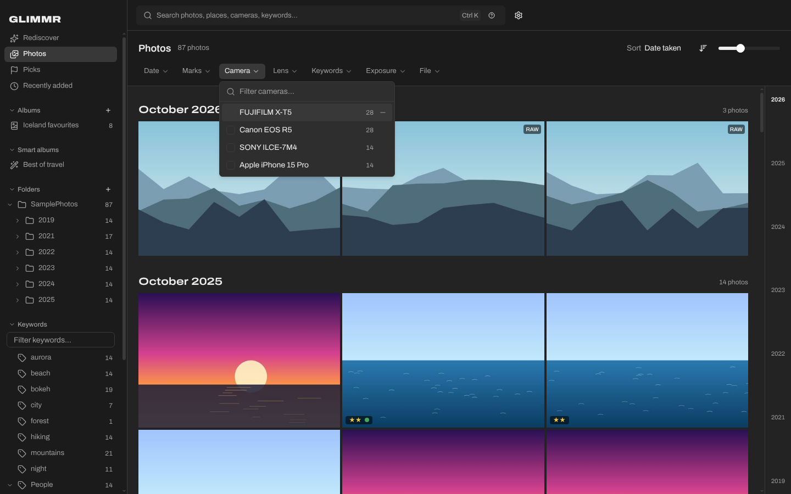
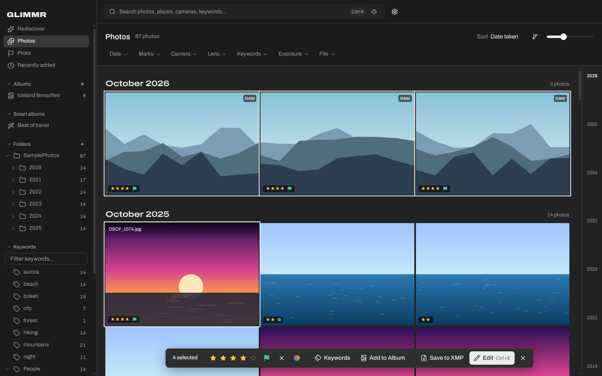
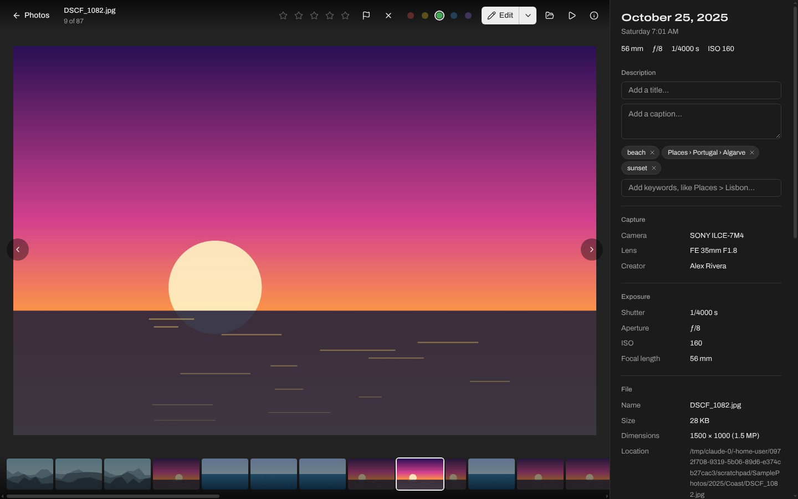
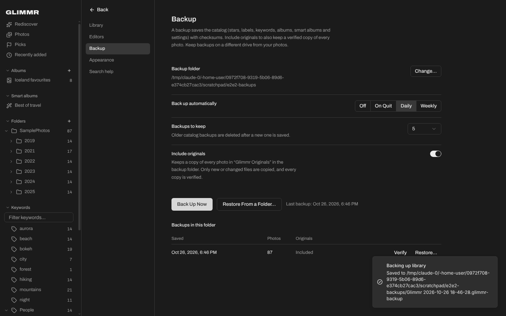
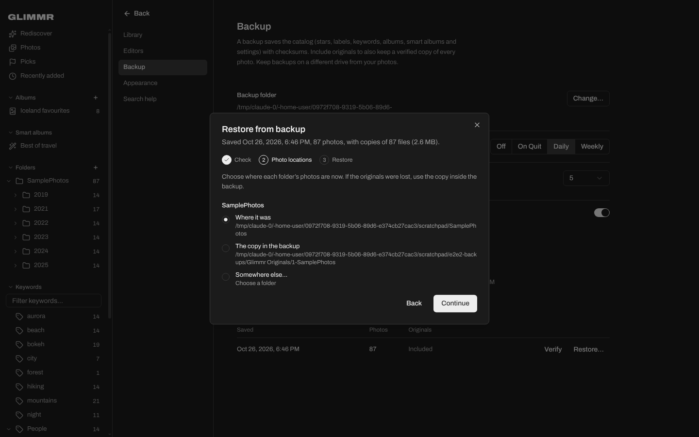

# Glimmr

**A calm, fast desktop library for your photos.** Glimmr stores, sorts, organizes, searches and shows a personal
photo collection on Windows and macOS. It browses like a stock-media site (one big search box, a filter bar and a
grid of photos at their true shapes) and hands photos to Lightroom, Capture One or any editor you choose. It does not
edit photos.



- **Your files stay where they are.** Add folders; Glimmr catalogs them in place and never edits a photo. It only
  moves, renames or deletes files when you ask, and deletes always go to the system trash.
- **Every common format.** JPEG, HEIC/HEIF (iPhone, and Canon/Fujifilm/Sony `.hif`), AVIF, JPEG XL, PNG, TIFF, WebP,
  GIF, BMP and Photoshop (PSD/PSB), plus raw files from every major maker: Canon (CR3, CR2, CRW), Nikon (NEF, NRW),
  Sony (ARW, SRF, SR2), Fujifilm (RAF), Olympus/OM System (ORF), Panasonic (RW2, RAW), Leica (RWL), Pentax (PEF),
  Samsung (SRW), Sigma (X3F), Hasselblad (3FR, FFF), Phase One (IIQ), GoPro (GPR), Adobe DNG and older Kodak,
  Minolta, Mamiya, Leaf, Epson and Sinar formats. Filter by file type, or search `type:raw`, `type:cr3`,
  `-type:jpeg`.
- **Search by anything.** Free text over every field, plus `camera:"X-T5"`, `iso:>1600`, `focal:24..70`,
  `date:2019-07`, `rating:>=4`, `-keyword:test`, and any raw EXIF/IPTC/XMP key such as `ExposureProgram:Manual`.
  Sort by any field too.
- **Facets with counts.** Year, rating, flag, color label, camera, lens, keywords, file type, orientation, and
  ISO/focal/aperture ranges. Click to include, ⊖ to exclude. Save any search as a smart album.
- **Import from cards.** Plug in a card and Glimmr offers to import it. See what's new (photos already in the library
  are recognised by content, whatever their name), cull on the card, and copy into dated folders
  (`{YYYY}/{YYYY-MM-DD} {event}` or your own template). Every copy is checked against the original, an interrupted
  import picks up where it stopped, and the card is never changed or deleted from.
- **Cull with the keyboard.** A full-screen cull view (`Ctrl/⌘ Shift C`) with a filmstrip, `P` pick, `X` reject,
  `U` unflag, `0–5` stars, `6–9` colour labels, auto-advance, and 100% zoom that stays on the same spot from photo to
  photo. *Delete Rejects* sends rejects to the trash.
- **RAW + JPEG pairs as one photo.** The RAW is the main file (editing, *Open RAW in…*, XMP); the camera JPEG is what's
  shown. Rating, moving and deleting treat them as one; either half can be deleted on its own.
- **Duplicates.** Exact copies and the same picture under another name or with other metadata, with the best copy
  suggested. Merging keeps one and gives it the others' ratings, keywords and albums.
- **Folders in the sidebar.** Drag photos or folders onto a folder to move them (`Alt`/`Option` copies), and new
  folder, rename (`F2`), move, copy and delete. Pairs and sidecars go along, and marks, albums and edits are kept.
- **Rewarding to browse.** Rediscover home with *On this day*, highlights, *A look back*, shuffle and slideshow.
- **Rotate, straighten and crop, non-destructively.** Press `R` in the viewer for the crop tool (aspect presets,
  straighten up to ±45° with the crop kept inside the photo), or `[` / `]` to turn photos a quarter anywhere.
  Edits live in the catalog and in backups; originals are never touched, and *Reset to original* undoes them.
- **Technical detail.** A live RGB/luminance histogram with clipping warnings, plus exposure value, 35 mm
  equivalent and crop factor, field of view, metering, flash, white balance, colour space and profile, bit depth,
  serial numbers and more, with EXIF codes shown as words.
- **Print like a pro.** `Ctrl/⌘ P` opens a print workspace with a live page preview:
  - **Layouts:** single photos, grids and contact sheets, or picture packages that mix sizes (5×7, wallets,
    passport photos…) on one sheet, laid out so it can be cut apart with straight cuts.
  - **Cropping and borders:** fit or fill, with drag-to-crop; borders, strokes and crop marks.
  - **Text:** captions, header and footer, watermark.
  - **Quality:** 180–720 ppi, print sharpening for glossy or matte, and print brightness and contrast.
  - **Colour management** with Little CMS: your paper's ICC profile with any rendering intent and black point
    compensation, soft proofing, and a gamut warning.
  - **Output:** any printer, a PDF, or JPEG/TIFF files tagged with the profile for a lab.
  - **Printer settings** from the printer's own driver, for any brand (Epson, Canon, HP, Brother…): paper
    source (tray), media type and print quality, remembered per printer. On Windows, Printer preferences… opens
    the manufacturer's settings window.
  - **Presets**, a profile manager, and a printable calibration chart.
- **Open in your editor.** `Ctrl/⌘ E` opens the selection in your default editor, with per-type defaults
  (e.g. RAW → Capture One, JPEG → Photoshop). Editors are detected automatically, and you can add any app.
- **Backup and restore.** Catalog backups with checksums and SQLite integrity checks, on a schedule with
  retention, plus an optional verified, incremental mirror of the originals. The restore wizard verifies the
  backup and lets you remap each library folder, including to the backup's own copy of the originals.
- **Smart tags, on your computer.** Turn them on and Glimmr describes each photo with up to 8 of nearly 800 tags:
  what's in it, from broad to specific (*bird → heron*, *dog → border collie*, *food → ramen*, *building → castle*,
  famous landmarks), where (*mountains → alpine meadow*, *coast → cliffs*), what people are doing (*surfing*,
  *cooking*), and the look (*golden hour*, *fog*, *autumn*, *reflection*, *moody*, *pastel*). `heron` or
  `auto:"golden hour"` then finds photos you never tagged. It uses OpenAI's CLIP model, downloaded once (92 MB), and
  photos never leave the machine. Wrong tags can be removed from a photo's info panel.
- **Interoperable.** Reads ratings, labels and keywords from Lightroom, Capture One, Bridge and darktable sidecars.
  It can write them back to XMP sidecars, merging with existing ones.

| Photos by month | Filters |
|---|---|
|  |  |
| **Culling a selection** | **Viewer** |
|  |  |
| **Backup** | **Restore** |
|  |  |

Product docs: [research](docs/RESEARCH.md), [PRD](docs/PRD.md) and [UI design](docs/DESIGN.md).

## Design

The interface follows [docs/DESIGN.md](docs/DESIGN.md). Photos sit on neutral grey so their colours read
correctly, every photo keeps its real shape in justified rows grouped by month, and a year scrubber jumps
through time. It's built with shadcn/ui (Radix) and Tailwind CSS v4, and checked against Vercel's Web Interface
Guidelines and Anthropic's frontend-design guidance.

The app icon is a "G" from **Rubik Mono One**, a wide, heavy open-licence face in the spirit of Akira Expanded,
converted to an outline (`npm run icon` regenerates it). All interface text is **Archivo**, whose width axis gives
headings wide proportions. Both fonts are SIL OFL.

## Run it

Requirements: Node.js 22+ and npm.

```bash
npm install
npm run dev        # development with hot reload
npm run build      # production build into out/
npm start          # run the production build
npm test           # unit + integration tests (catalog, search, scanning, backup/restore, XMP, editors)
npm run typecheck
```

### Installers and automatic builds

GitHub Actions (`.github/workflows/build.yml`) runs on every push:

1. Typecheck and tests on Linux.
2. **Windows** installer (`Glimmr-<version>-Windows-Setup.exe`, x64 and ARM in one installer) built on Windows.
3. **macOS** disk images for Apple Silicon and Intel (`Glimmr-<version>-macOS-arm64.dmg` / `-x64.dmg`) built on macOS.

Branch builds attach the installers to the workflow run (Actions tab → run → Artifacts).

To build locally on the matching OS: `npm run dist:win` or `npm run dist:mac`.

### Publishing an update

Installed copies of Glimmr check this repository's **GitHub Releases** shortly after they start and every 4 hours.
They download new versions in the background and offer **Restart to Update** in the sidebar and in
Settings → Updates.

To publish a version:

```bash
npm version 1.1.0          # bumps package.json and creates the tag v1.1.0
git push --follow-tags     # CI builds both platforms and publishes the release
```

Or, without pushing a tag: set the version in `package.json` and push a commit whose message contains `[release]`.
You can also open **Actions → Build → Run workflow** and tick **release**. Either way, CI tags `v<version>` itself.

Either way, CI creates a draft release, uploads the Windows and macOS installers plus the update manifests (`latest.yml`,
`latest-mac.yml`), and publishes the release only after both platforms succeed. Installed apps never see a
half-finished release. A tag that doesn't match `package.json` fails the build.

### Code signing

Builds work without certificates, with these limits:

- **Windows:** unsigned installers show a SmartScreen warning the first time. Updates install normally.
- **macOS:** builds are ad-hoc signed. People open the first install with right-click → Open. macOS only lets an app
  replace itself when it's signed with an Apple Developer ID, so unsigned builds show **Get the New Version**,
  which opens the release page, instead of updating in place.

For silent updates on macOS and no warnings, add these repository secrets (Settings → Secrets and variables →
Actions): `MAC_CSC_LINK` (base64 Developer ID Application .p12), `MAC_CSC_KEY_PASSWORD`, `APPLE_ID`,
`APPLE_APP_SPECIFIC_PASSWORD`, `APPLE_TEAM_ID`. For Windows, add `WIN_CSC_LINK` and `WIN_CSC_KEY_PASSWORD`.
CI picks them up automatically, and macOS builds are then notarized too.

Set `GLIMMR_USER_DATA=/some/folder` to keep the catalog somewhere other than the default app-data folder (for
portable use or testing).

## How it works

```
Electron main (Node)                                    Renderer (React + shadcn/ui + Tailwind)
 ├─ catalog.db  SQLite (node:sqlite, WAL, FTS5)          ├─ Search bar with autocomplete + chips
 ├─ scanner     walk → exifr metadata → sharp previews   ├─ Filter bar, justified grid, selection bar
 ├─ query       search syntax → parameterized SQL        ├─ Viewer, Rediscover, Settings
 ├─ editors     detect + launch                          └─ talks to main via a typed IPC bridge
 ├─ tagging     CLIP image encoder (ONNX Runtime), smart tags
 ├─ backup      VACUUM INTO snapshot, SHA-256 manifest,
 │              originals mirror, verify, restore
 └─ glimmr://   thumbnails, previews and originals
```

- **Catalog**: `photos` (normalized fields), `metadata` (every EXIF/IPTC/XMP key/value, numeric values typed for
  comparisons and sorting), `keywords` (hierarchical, `Places>Portugal>Lisbon`), `albums`, `smart_albums`,
  `settings`, and a full-text index over all text.
- **Formats** (`src/shared/formats.ts`): one table of every format, its extensions and whether it's raw, used by
  the scanner, `type:` searches, the File type filter and editor rules.
- **Previews**: RAW files are never decoded. Glimmr extracts the largest embedded JPEG that libjpeg can read (not
  the lossless-JPEG sensor data in CR2s and many DNGs), which is why browsing RAW is fast; Sigma X3F previews come
  from the file's own section directory. sharp reads JPEG, PNG, WebP, AVIF, TIFF and GIF. The rest are decoded by
  Glimmr (`src/main/decode`) on worker threads, so the app stays responsive: HEIC with libheif compiled to
  WebAssembly (`libheif-js`, LGPL; keeps the embedded Display P3 profile), JPEG XL with `jxl-oxide-wasm`, and
  Photoshop (the saved composite, any depth, RGB/grey/CMYK/Lab/indexed, with its ICC profile) and BMP (every bit
  depth, bit fields, RLE) with small built-in readers. Formats Chromium can't display are viewed through 2560 px
  previews; JPEG, PNG, WebP and AVIF show the original at 100% zoom.
- **Your data**: the catalog lives in the app-data folder (`%APPDATA%\Glimmr\Library` or
  `~/Library/Application Support/Glimmr/Library`). Previews are a disposable cache.
- **Smart tags**: the CLIP ViT-B/16 image encoder runs through ONNX Runtime on thumbnails, in the background after
  each scan. Each photo's embedding is kept (512 bytes) along with its tags (`photo_tags`, in the full-text index).
  Tags come from a vocabulary of 43 label groups (`scripts/clip-vocabulary.json`). Each group is a softmax over
  alternatives, including "nothing in particular" options, so a tag is kept only when it clearly wins. Specific
  groups are only scored under their broad tag (bird → bird species). The label text embeddings are computed ahead
  of time by `scripts/build-clip-labels.py`, so the text model never ships. When the vocabulary changes, libraries
  are re-tagged from their stored embeddings in seconds, without the model. The model is downloaded on demand from
  this repository's `models-v2` pre-release and checked against the SHA-256 in `src/main/tagging/model.json`. CI
  rebuilds it reproducibly (`.github/workflows/models.yml`): the original ONNX export, 8-bit weight-only quantized
  (345 → 92 MB, cosine ≥ 0.9996 to the original). It's tuned on ImageNet's 1,000 sample photos, where B/16 names 66%
  of them exactly (B/32: 60%). It takes about 0.1–0.3 s per photo on a laptop CPU, using half the cores.
- **Edits**: a rotation, straighten angle and crop per photo (`photos.edit`, see `src/shared/edit.ts`). Thumbnails and
  previews are rendered with the edit applied; the unedited upright preview is kept for the crop tool, and 100% zoom
  renders the edited original on demand. Editors are still sent the original file.
- **Import, culling, duplicates, pairs and folders** ([research](docs/IMPORT_RESEARCH.md), [PRD](docs/IMPORT_PRD.md)):
  - **Files of a photo** (`src/main/files.ts`): the main file, the camera JPEG of a pair (same folder, same name,
    capture times within 2 s) and sidecars (`IMG.xmp`, `IMG.CR3.xmp`, `.AAE`, `.THM`, Capture One `.cos`). Every move,
    delete, backup and import works on that set.
  - **File operations** (`src/main/fileops.ts`): verified copies (SHA-256 while reading, `.glimmr-part`, flushed,
    read back, renamed into place), moves that fall back to a verified copy across drives, no overwriting, trash only.
  - **Import** (`src/main/importer.ts`, `src/main/volumes.ts`): cards are found by polling mounted volumes for a
    `DCIM` folder. Already-imported photos match on size and a quick hash, or size, type and capture time; before
    skipping, a full hash confirms. Each copied file is recorded in `import_files` as it completes.
  - **Duplicates** (`src/main/duplicates.ts`): quick hash and a 64×64 pixel hash of the upright preview at scan time,
    SHA-256 only where quick hashes collide.
  - **Folders** (`src/main/folders.ts`): moves update photo paths in place, so ids, marks and previews survive; a
    `folders` table keeps empty folders.
- **Printing** ([research](docs/PRINT_RESEARCH.md), [PRD](docs/PRINT_PRD.md)):
  - **Layout:** pure geometry in inches (`src/shared/print.ts`) drives the live preview and every output.
  - **Rendering:** photos are rendered in the main process (`src/main/print`) from the full-resolution original,
    with the photo's edit, the cell's crop, a Lanczos resample to the exact print size, print adjustment and
    sharpening.
  - **Colour:** Little CMS 2.16 as WebAssembly (vendored from lcms-wasm, MIT) handles profile conversion,
    rendering intents, black point compensation, soft proof and gamut warning. sharp only offers perceptual.
  - **Output:** the pages are an exact-size HTML page rendered in a hidden window, so text stays vector. Files
    are composited at print resolution with the profile embedded but not converted twice.
  - **Printer settings** (`src/main/print/driver.ts`): Chromium's print path can't set the tray, media type or
    quality, so the driver used its default tray. On macOS and Linux every printer is a CUPS queue whose options
    `lpoptions -l` lists (labels come from the PPD when readable), so silent prints go to CUPS as a PDF with `lp`,
    the chosen options, and the paper's standard name (its borderless variant for zero margins). On Windows,
    `printui.dll,PrintUIEntry /e` opens the driver's Printing Preferences, which silent prints start from, and
    standard papers are passed by name so the driver matches its own size.
  - **Tests:** an end-to-end test prints through a real CUPS printer, including one with three trays.
- **Editors**: Lightroom Classic and Capture One are catalog-based, so opening a file outside their catalog
  shows their import window. Ratings and keywords only reach them through XMP sidecars (Settings → Library →
  *Write XMP*, or *Write XMP* on a selection).

## Keyboard

| Key | Action |
|---|---|
| `/` or `Ctrl/⌘ K` | Search |
| Arrows, `Home`, `End` | Move; `Shift` extends the selection |
| `Enter` / double-click | View |
| `0`–`5` | Star rating |
| `P` / `X` / `U` | Pick / reject / unflag |
| `6`–`9` | Red / yellow / green / blue label |
| `Ctrl/⌘ E` | Open in editor |
| `Delete` / `Backspace` | Move to the Recycle Bin / Trash (asks first) |
| `R` | Crop and rotate (viewer); `Enter` saves, `Esc` cancels |
| `Ctrl/⌘ P` | Print the selection or the current photo |
| `[` / `]` | Rotate left / right |
| `S` | Slideshow |
| `I` | Info panel (viewer) |
| `Z` / `Space` / click | Toggle fit and 100% (viewer) |
| Scroll wheel / `+` / `−` | Zoom in and out around the pointer; drag to move a zoomed photo (viewer) |
| `Ctrl/⌘ A`, `Esc` | Select all, clear / back |
| `Alt ←` / `Alt →` (Windows), `⌘ [` / `⌘ ]` (macOS), mouse side buttons | Back / forward |
| `Ctrl/⌘` + scroll, or pinch | Photo size in the grid |

## Performance

Measured on a synthetic catalog of 100,000 photos (15 metadata fields and 2 keywords each) in this
project's Linux container, query time only:

| Query | Time |
|---|---|
| All photos, newest first | 115 ms |
| Free text (`beach`, prefix `moun`) | 32–48 ms |
| `keyword:=dog`, `date:2010..2012 rating:>=3` | 35–47 ms |
| Sort by a raw metadata key | 134 ms |
| `ShutterCount:>150000` / `ExposureProgram:Manual` | 110 / 233 ms |
| `camera:"EOS R5" iso:>1600` (substring match over all rows) | 305 ms |
| Exclusions matching 77% of the library | 466 ms |
| Facet panel (computed after results, in the background) | ~600 ms |

Most searches meet the PRD's 150 ms target. Substring matches on camera and broad exclusions don't yet.

## Status

v1.0 MVP: the PRD's P0 requirements are implemented, with these gaps:

- Dragging photos onto an album (ORG-1) isn't built yet. Use the selection bar, the context menu or "+" in
  the sidebar instead.
- Performance targets are met for most queries; see the table above.

Planned next (P1): folder watching, RAW+JPEG stacking, map view, color search, compare view and automatic XMP
writing.
